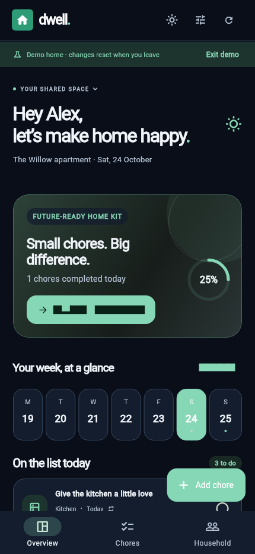
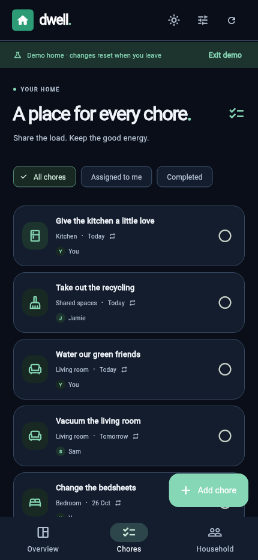
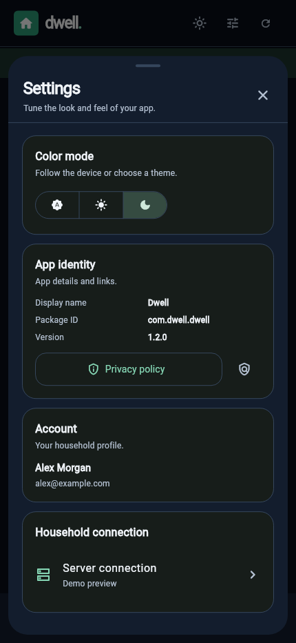

# Dwell

Dwell helps people in an apartment share chores, assign work to housemates, and keep recurring tasks moving. The Flutter app pairs with a small SQLite-backed API and uses a simple white home mark on a green tile, with a calm green interface.

Open Settings to choose System, Light, or Dark appearance. The home header keeps a quick light/dark toggle, and the selected mode is saved on the device.

The green home launcher icon has transparent rounded corners; maskable web icons use a full-bleed green background for clean install previews.

## Dark mode screenshots

Captured at 430 × 932 in the demo home.

| Overview · dark | Chores · dark |
| --- | --- |
|  |  |

| Shared settings · dark |
| --- |
|  |

## Local setup

Install Flutter 3.47.7 (and Android SDK tools for Android builds), plus Python 3. The `scripts/flutterw` wrapper prefers a project-local SDK at `.tooling/flutter`; if it is absent, it uses `flutter` from `PATH`. Pub, Gradle, Android, and Flutter config/cache files are directed to `.tooling/`.

Build the web app, then run the API and static web host on port 8080:

```sh
./scripts/flutterw pub get
./scripts/flutterw build web --release --no-web-resources-cdn
DWELL_PORT=8080 DWELL_DB=./data/dwell.sqlite DWELL_WEB=./build/web python3 backend/server.py
```

Open `http://localhost:8080`. The browser app uses the same-origin API automatically. Check the service at `http://localhost:8080/api/health`. Secure browser storage requires HTTPS or localhost; use the Android app for plain HTTP access on your home network.

To try the interface without creating an account or starting a server, select **Explore a demo home** on the sign-in screen. Demo changes are temporary, reset when you leave, and are not shared with other users. To use real data, create an account, create a home, then share its invite code from the Household tab so housemates can join with their own accounts.

Choose **Use offline mode** to manage a personal home without connecting to a server. Chores are saved on this device and remain available after reopening the app. Offline homes are not shared or synced; connect to a Dwell server and sign in to use household features.

## Android

Build APKs with `./scripts/flutterw build apk --debug` or `./scripts/flutterw build apk --release`; APK builds remain signed with Flutter's development debug key for local installation. For Google Play, build a release app bundle with `./scripts/flutterw build appbundle --release`. The bundle is signed with the upload key configured in `android/key.properties` and written to `build/app/outputs/bundle/release/app-release.aab`.

The upload keystore (`android/app/dwell-upload-key.jks`) and `android/key.properties` are ignored by Git. Back up both securely; losing the upload key can prevent future updates if Play App Signing is not enabled. Do not commit or share the key publicly. The privacy policy source is the repository-root `index.html`; enable GitHub Pages for the `main` branch and root folder so it is available at [jan-lederer.github.io/Household](https://jan-lederer.github.io/Household/).

Android emulators default to `http://10.0.2.2:8080`. To connect a phone to a home server, set Dwell's server address to the computer's LAN address, such as `http://192.168.1.20:8081` for Docker (`:8080` for direct Python); both devices need to be on the same network and the host firewall must allow the selected host port (8081 for Docker). You can also set the default at build time with `--dart-define=API_URL=http://192.168.1.20:8080`. Local HTTP is enabled for home-network use. Use HTTPS before exposing the service to the public internet; do not send passwords over public plain HTTP.

## iPhone

The `ios/Runner.xcworkspace` project is the native Flutter iOS app, with bundle ID `com.dwell.dwell` and the matching green app icon. Build and sign it on a Mac with Xcode. The source handoff is `artifacts/dwell-ios-project.zip`. On the Mac, unzip it, run `flutter pub get`, open `ios/Runner.xcworkspace` in Xcode, select your development team under **Signing & Capabilities**, then run on a connected iPhone or use **Product → Archive** to prepare a TestFlight/App Store upload. Set Dwell's server address to an HTTPS URL; iOS does not use the Android emulator address. The iOS target can be tested on a personal device with Xcode; TestFlight and App Store distribution require Apple Developer Program membership. This Linux workspace can generate and check the iOS project, but cannot compile or sign it.

## Docker

Docker builds the Flutter web client with Flutter 3.47.7 and runs the API and web client together:

```sh
docker compose up --build -d
curl http://localhost:8081/api/health
docker compose ps
```

Open `http://HOST_ADDRESS:8081`, using the same host address as Pocket Codex. Docker explicitly publishes `0.0.0.0:8081` and forwards to container port 8080. Port 8080 on this host already belongs to Dataset Management. Set `DWELL_HOST_PORT` / `DWELL_BIND_ADDRESS` in `.env` to override the mapping. SQLite data persists in `./data/dwell.sqlite` across container recreation. Back up the `data/` directory. The container health check queries `/api/health`. Stop the service with `docker compose down`.

For internet access, put the service behind a trusted TLS reverse proxy, restrict who can reach it, and back up the database. The bundled server is intended for a small household, not as a hardened public-facing service by itself.

## Checks and icon assets

Run Flutter static analysis and widget checks with `./scripts/flutterw analyze` and `./scripts/flutterw test`. Run the backend API integration suite with `python3 -m unittest discover -s backend -p 'test_*.py'`. The vector source is `assets/dwell-mark.svg`; regenerate launcher and web PNGs with `python3 scripts/generate_icons.py`.

## Prebuilt host bundle

After building the web app, run `python3 scripts/package_host.py`. The verified `artifacts/dwell-host.zip` includes the web client, dependency-free backend, and a lightweight Docker configuration that does not need Flutter on the host.

## Expose on the Pocket Codex host

The current host Docker worker has `dwell` registered, and deployment is verified on host port 8081. Redeploy it with `pocket-docker deploy dwell`, save the returned job UUID, then check `pocket-docker job JOB_UUID` and `pocket-docker status dwell`.

For first-time registration on another host, run this on the **Docker host** from the Pocket Codex repository directory:

```sh
python3 Household/scripts/deploy_host.py
```

The script preserves existing worker targets, backs up its private configuration, adds `dwell`, restarts the idle worker, and queues its deployment. It uses `Dockerfile.host` with the existing verified `build/web` assets, so the host needs no Flutter SDK. It saves the accepted job UUID before waiting, checks the terminal result, published host port and API health, and writes results under `artifacts/deployment-result.json`. It refuses to restart the worker while jobs are queued/running. On this installation the full command is `python3 /home/jan/projects/code/Household/scripts/deploy_host.py`.

After this one-time registration, save `pocket-docker deploy dwell` in this project's Deployment settings. Future deployments can run directly from the phone. The app's server address is `http://SAME_HOST_AS_POCKET_CODEX:8081`. Host health endpoint: `http://127.0.0.1:8081/api/health`. The worker's private allowlist is outside the app container, so workspace edits alone cannot activate the port mapping.

## Shared template icons

The common toolbar and Settings icons use `TemplateIcons` from
`lib/template_icons.dart`, mapped to the same built-in Material glyphs used by
Template. A small licensed Material Icons subset is also retained at
`assets/icons/template-material-icons.ttf` for derived app surfaces. It permits
commercial use under CC BY 4.0; the license and attribution are in
`assets/icons/MaterialIcons_LICENSE.txt` and `THIRD_PARTY_NOTICES.md`.
